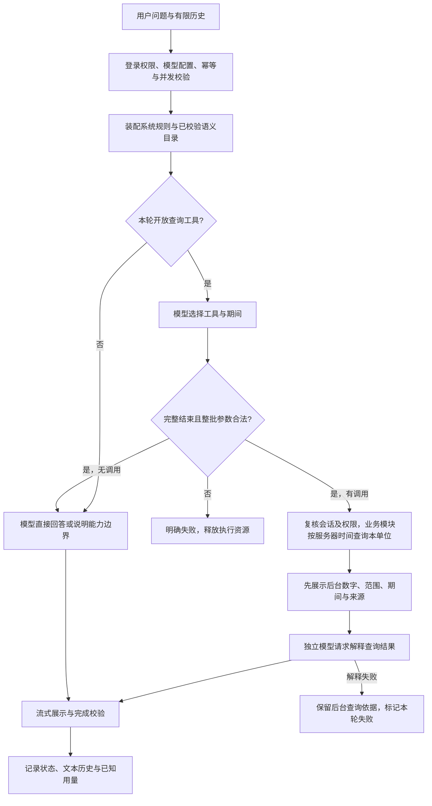

# 海防助手受控查询与 Function Calling 首版

> **已废弃（2026-10-12）**：旧站内助手及其 Java 对话、模型供应商、固定资料库、Function Calling 路线已退役（V57）；文中执行提示、接口、权限和路径仅用于历史追溯，不应继续实现或恢复。 当前入口：[独立 Agent 运行说明](../../tasks/agent-readonly-query.md)；范围与语义：[现行设计](../../tasks/agent-query-scope-management-plan.md)。以下保留历史原文。

> **已废弃（2026-10-11）**：站内助手的 Function Calling 与本机 Agent 的直连视图/环境变量实验均已移除；独立 Agent 的业务查询将在「智能体管理 → 数据源管理」的配置与检查之上重新设计。本文档仅作历史记录，不再代表当前实现。

日期：2026-10-10。用户确认采用现有 Java 后台的受控查询能力与 Function Calling；MCP、Skills 留待实际复用和专题流程需要时再建设。先记录方案，再开发、验证。

## 范围与规则

- 首个工具 `query_completed_task_count` 对应正式定义 `task.completed-count` revision 3。只接收 `period=THIS_MONTH|LAST_MONTH|ROLLING_MONTH`；不接受当前时间、起止日期、单位、身份、权限、SQL、表名或任意 URL。
- 任务模块公开统计能力：当前有效登录账号所属单位发起、总体状态为 `COMPLETED`、确认办结时间位于统计期间的整项任务数。工具执行内部先读服务器系统时钟，以北京时间解释范围：本月从本月一日零点至查询时刻；上月为上一完整自然月；最近一个月从查询时刻倒推一个日历月。查询时刻按数据库支持的微秒精度固定，范围起点包含、终点不包含。按任务主表计数，不关联承办分支放大数量。
- 对话仍要求 `agent:chat:use`，执行统计还要求 `task:handling:read`。执行前后核验会话、账号/单位状态和授权版本；管理员身份不扩大业务范围。
- 查询成功为零与无权限、会话失效、数据库失败分别表达。返回值与来源由服务端生成，禁止模型生成 SQL 或提交身份。只返回必要汇总，不返回任务正文与明细。

## 链路与兼容

1. 任务模块公开明确的只读统计能力，复用本模块 Mapper；Agent 不导入任务 Mapper，也不复制任务权限规则。
2. 语义模块向工具提供正式指标确认能力；工具启动时核对指标编号、已确认状态和实现支持的 revision，定义变更不能静默继续使用旧算法。
3. 首版启用 DeepSeek、千问的工具接入；其他供应商保留普通对话并如实声明没有查询工具，不按“兼容接口”推断全部行为相同。
4. DeepSeek 工具选择阶段关闭思考；千问平台按配置档位或模型默认执行，不统一发送关闭思考参数（其中存在强制思考模型）。接收官方流式 `tool_calls` 分片并完整组装；不展示或执行未完成的参数。最终解释使用独立的普通对话请求：仅带原文字历史，以及服务端填入系统上下文的 `<server_query_results>` 结构化结果数据，不带 `assistant.tool_calls`、`role=tool` 或隐藏思维链，不再声明工具，继续使用用户选择的推理强度。结果字符串是数据而非指令，JSON 中的尖括号转义后仍保留字段原值。这样无需落库隐藏思维链，也避免把非思考工具回合混入供应商的思考历史。通常一次工具选择加一次最终解释，代价是额外模型请求及其耗时/用量；用量跨请求累计，任一请求用量缺失即保持未知。
5. 最多受理两个工具调用，先验证整批调用再执行；同一轮相同工具与参数复用本轮结果。调用与最终回答共享总期限，停止/断连时关闭上游，不能因为等待一行 SSE 而绕过停止与期限。
6. 后台以已有 TEXT 部件直接展示查询数字、期间、范围、定义版本、来源与查询标识，模型另作解释。两部分一起进入现有纯文本历史，刷新后仍保留依据；系统指令、凭据、原始工具协议与思维链不进入用户消息。

供应商依据（2026-10-10 核对）：[DeepSeek 工具调用](https://api-docs.deepseek.com/guides/tool_calls/)、[思考与工具历史规则](https://api-docs.deepseek.com/guides/thinking_mode/)、[Chat Completions 参数](https://api-docs.deepseek.com/api/create-chat-completion/)、[千问 Function Calling](https://help.aliyun.com/zh/model-studio/qwen-function-calling)。具体模型及实际连接仍需真实供应商验收，不能由替身推断全部兼容。

## 实施与验收

1. 增加 `task/TaskStatisticsLookup`、Mapper 固定统计 SQL及语义的指标确认能力。用隔离真实 MySQL验证本单位范围、承办任务排除、多分支不重复、未总体确认排除、UTC+8 月界、成功为零、授权失效。
2. 增加对话内部工具执行器、上游工具分片组装与两阶段编排；供应商公开目标增加厂商标识，选择/回答各自使用正确请求参数。复用 SSE、会话及现有依赖。
3. 更新语义使用说明和工具指引；不再写死“当前没有查询工具”，以本次提供的工具及结果为能力依据。
4. 用本机 HTTP 替身与真实登录、SSE、MySQL 验证完整链路：工具声明、分片参数、调用 ID、结果回传、服务端结果展示、刷新历史、累计/未知用量、非法工具/参数、配额、取消、断流和过期会话。替身不在开发或交付环境自动注册。
5. 容器 JDK 21 执行相关回归及打包；前端类型、现有状态/协议测试、契约测试和构建。沿用现有 SSE/历史结构，不手改生成契约；若实际接口形状改变，再从当前后端重新生成。
6. 重启本地 API，检查 readiness 与本地接口；浏览器和真实模型效果交由用户验收。本轮不安装依赖、不真实调用模型、不连接旧库或生产、不改数据库结构、不提交/推送或清库/删卷。

## 执行记录

- 已完成任务模块公开统计、指标版本核对、工具白名单与严格参数校验、流式分片组装、两阶段编排及服务端查询依据展示。没有新增依赖、数据库迁移、前端 API 形状或工具服务。
- `SecurityConfig` 仅允许已受理 `POST /api/agent/chat` 的内部 ASYNC 收尾，解决查询等待期间退出登录后无法正确结束 SSE 的问题；初始 HTTP 请求继续认证和验权，执行前后另核验当前有效会话。
- 容器 JDK 21 `./mvnw -B -q -Dtest='Chat*Test,Provider*Test,Semantic*Test,TaskStatistics*Test,TaskHandlingRegressionTest,AuthSessionRegressionTest' package`：125 项通过，无失败、错误或跳过。数据库为专用 `merine_rebuild_test`，上游为测试内本机 HTTP 替身。
- 其中函数调用 HTTP 回归 17 项覆盖：真实 MySQL 数字、上月追问、纯文本历史依据、工具分片、相同期间去重、零结果、非法参数/工具/重复 ID/不完整计划、最终模型失败、用量累计与未知、退出/改权限后禁止查询、半帧阻塞时停止与总期限、无任务权限不开放工具。任务统计另覆盖 UTC+8 月界、年界与闰月、本单位发起和本单位承办的区别、多分支不重复及待总体确认排除。
- 前端类型检查、137 项现有测试、7 项契约测试、全仓 Prettier 检查与 Vite 构建通过；`git diff --check` 通过。沿用已有 TEXT 部件及会话契约，没有手改生成文件。
- 已执行 `./scripts/dev.sh restart api`；本地 API readiness 为 `UP`，三个开发服务均为 healthy，未登录访问对话配置仍返回 401。本轮未操作浏览器、未调用真实模型；模型能否正确选择工具与页面体验由用户验收。跨单位、任意期间、任务明细、其他指标与更多厂商工具适配仍未实现。

## 2026-10-10 结果解释请求兼容修正

- 用户实际测试已得到后台查询结果，但后续模型解释报 `MODEL_REQUEST_REJECTED`。本地运行记录确认失败发生在 DeepSeek Flash、高推理的查询轮次。旧实现丢弃上游错误体、只对 HTTP 400/422 给出泛化提示，无法还原这次供应商拒绝的具体原因。
- 代码存在工具历史兼容缺口：选择阶段关闭思考，最终阶段切回高推理，却回传不含 `reasoning_content` 的工具调用回合。DeepSeek 官方明确其工具历史需要保留该字段，见 [Oh My Pi 接入说明](https://api-docs.deepseek.com/quick_start/agent_integrations/oh_my_pi/)。本机严格替身拒绝这种混用格式时，原正常查询回归失败；这是兼容风险的本地复现，不代表已取得实际供应商的原始拒绝详情。
- 按上述链路改为独立解释请求，保留原推理档位。后台结果只由本轮 Java 查询生成，重复期间只传一份；不把用户文字或旧回答当作新查询结果，不伪造或落库思维链。
- HTTP 拒绝日志增加消息标识、调用阶段、状态码和固定分类。错误体仅在内存中限量读取 8 KiB，按固定关键词分类，畸形、空或超长内容降为未知；不回显或记录原文。读取仍受停止、断连和总期限约束，查询结果在模型解释失败后保留；不自动重试或降档。
- 容器 JDK 21 执行 `./mvnw -B -q -Dtest='ProviderToolCallingRegressionTest,ProviderChatRegressionTest,ProviderChatClientTest,ChatProtocolTest,Semantic*Test' package`：63 项通过，无失败、错误或跳过。新增严格工具历史拒绝、双期间数据回传、资料分隔符转义、400/422 固定分类与脱敏、畸形/超长错误体、读取错误体时停止与超时的覆盖；上游仅为本机替身，数据库为专用 `merine_rebuild_test`。
- 同步修正身份提示词中“无工具或有效结果”的歧义后，`ProviderToolCallingRegressionTest,ProviderChatRegressionTest` 共 34 项 HTTP 链路再次通过，后端打包通过。本轮没有改变 API 形状、前端、依赖、迁移或业务统计 SQL，未操作浏览器或真实模型；实际供应商结果解释仍待用户复测。

## 2026-10-10 服务器时间与查询期间调整

- 时间是查询的服务端必经步骤，放在现有查询函数内部，不依赖模型再申请一次独立的“取时间”调用。使用 Java `Clock.systemUTC()` 读取服务器时间，转换为北京时间计算范围；仅在测试上下文注入固定时钟，不新增依赖或基础服务。
- `THIS_MONTH` 为本月一日 00:00:00 至本次查询时刻；`LAST_MONTH` 为上月一日至本月一日；`ROLLING_MONTH` 为查询时刻减一个日历月至查询时刻。日历月倒推保留时分秒，上月没有同一天时取上月最后一天（含闰年规则）。每次查询内部只取一次时间，按 MySQL `DATETIME(6)` 支持的微秒精度固定，截止点、返回的查询时间和 SQL 上界一致；重复期间继续复用本轮首次结果。
- 工具只接受期间枚举，当前时间、起止日期、客户端时区和用户消息不参与服务端边界计算。返回实际 UTC 时刻 `startAt`、`endAtExclusive`、`queriedAt` 和统计时区，服务端结果展示转换为北京时间，不再仅显示日期或将本月延伸到下月一日。
- 同步更新唯一语义目录、模型指引与显示：目录和 `task.completed-count` 升为版本 3，`task.statistics-time` 升为版本 2，工具启动校验版本同步。API/SSE 结构和数据库结构不变，无需修改生成契约；原版本会话历史保持原样，不把旧回答伪称为本轮查询。
- 验证计划：纯函数核对 UTC+8 月界、年界、闰年和月末倒推；固定测试时钟加隔离 MySQL 核对起点计入、终点/未来排除与范围权限；本机 HTTP 模型替身核对三种枚举、时间不能由模型或客户端覆盖、展示与传给模型的截止点一致。之后打包、重启 API 并核对健康，浏览器与真实模型仍交由用户验收。
- 实际验证：容器 JDK 21、专用 `merine_rebuild_test` 数据源执行 `./mvnw -B -q -Dtest='TaskStatisticsTest,TaskStatisticsRegressionTest,ProviderToolCallingRegressionTest,ProviderChatRegressionTest,Semantic*Test' package`，69 项通过，无失败、错误或跳过。统计纯函数 10、真实 MySQL 统计 6、工具 HTTP 29、普通对话 HTTP 9、语义目录与上下文 15；其中确认未来记录不进入本月、微秒起止边界正确、最近一个月包含上月同日以来的任务、用户声称的 2099 年及客户端 UTC 不改变范围，模型提交时间参数整批拒绝。
- 后端打包、文档与 JSON 的 Prettier 检查、`git diff --check` 通过；API 已重启，readiness 为 `UP`，未登录资料库请求仍为 401，三个本地开发容器均为 healthy。本轮未新增依赖、数据库迁移、前端改动或真实模型调用，浏览器与真实模型仍由用户复测。

## 2026-10-10 基础链路复查

当前处理链路如下；语义读取是服务端装配同一份已校验定义，不是模型自行查询数据库。

本轮修正：

- 会话不存在或不属于本人时，释放已取得的并发名额并丢弃未受理记录，避免后续请求一直报“正在执行”。幂等摘要加入服务端会话标识；缺角色或最后一条不是用户提问在开流前拒绝。
- 上游 SSE 按事件而非单行解析，兼容多行 data 与 CR/LF/CRLF。正常完成须同时收到合法结束原因与 `[DONE]`；空回答、只有思考内容、资源不足等异常结束、不完整工具计划、结束后继续输出不再标记成功。单帧、整流、工具 ID 与参数都有边界；长文本拆为较小的下游事件。
- 千问平台不再被强制传入 `enable_thinking=false`。官方明确 GLM-5.3 等强制思考模型不接受该值，见 [千问 Chat Completions 参考](https://docs.qwencloud.com/api-reference/chat/openai-chat)。选择阶段保留已配置推理档位；最终解释仍使用原档位，不传思维链，不自动降档重试。
- 前端历史为最新问题预留总长度预算；重试不重复附加原问题，不把失败半句作为完整回答回传。流事件、停止回执、状态核对按当前执行标识隔离，重复点击重试也不会并发启动新轮次。解析失败或提前结束接收时主动取消响应流；CR 与 LF 跨网络块不会误拆帧。
- 工具去重键由工具层提供，包含工具名和已校验参数；通用编排不再直接依赖任务期间枚举。运行快照与文本更新使用同一把锁，避免查询状态与流式写入竞争。

扩展方式：新增 Function Calling 时，在工具层登记工具声明、严格参数校验与对应业务模块公开能力；权限、数据范围和查询计算留在业务模块。继续复用完整计划校验、单轮去重、总期限、SSE、错误处理和用量累计。当前仍是有界单轮编排，不先引入动态 SQL、无限工具循环或只有一个实现的通用框架。

实际边界：工具选择、自然语言解释仍有模型不确定性；后台结果块是可核对依据。普通对话在有工具权限时也会经过选择和回答两次请求，确有延迟与用量成本；后续可在明确模型能力并得到真实对比证据后，再决定是否复用无工具回合文本。当前执行登记仍在单进程内存，重启后运行中请求无法恢复；历史落库失败只记录日志，不承诺已经流出的回答必然持久化。需要跨重启恢复或业务写入工具时，应另做持久执行与幂等设计。

本轮验收：`./scripts/dev.sh check` 通过；按当前源码中的测试类核算，后端 311 项、前端 142 项、契约 7 项全部通过，无失败或跳过；类型与格式检查通过。前端生产构建及后端 `verify` 打包通过。已重启本地 API，readiness 为 `UP`，三个开发容器 healthy，未登录对话配置请求为 401。上游使用本机 HTTP 替身，数据库为隔离的 `merine_rebuild_test`；未调用真实供应商、未做浏览器验收，未新增依赖、迁移或修改生成契约，未提交或推送。

## 2026-10-10 千问流式工具标识兼容修正

- 用户使用 `qwen3.6-27b` 查询最近一个月时出现“模型工具标识无效”。本地检查发现组装器会拒绝后续分片的空 `id`；新增回归在修复前稳定复现同样错误。千问[官方流式示例](https://help.aliyun.com/zh/model-studio/qwen-function-calling)按调用序号组装，并仅收集非空标识。本轮未取得该次请求的原始上游分片，不能把本地复现等同于真实供应商响应取证。
- 空、null 或省略的分片标识不覆盖已有标识，重复相同标识继续接受；按 index 组装完整名称和参数后才进入工具校验。最终仍须具备有效标识，非法字符、超长、非字符串、标识改变、重复调用标识和不完整计划继续拒绝，不生成替代标识，也不放宽工具白名单、参数或业务权限。
- 容器 JDK 21 执行 `./mvnw -B -q -Dtest='ProviderToolCallCollectorTest,ProviderToolCallingRegressionTest,ProviderChatRegressionTest,ProviderChatClientTest,ChatProtocolTest' package`：74 项通过，无失败、错误或跳过。包含空/null/省略/重复标识的分片组装、畸形与缺失标识拒绝，以及本机千问 HTTP 替身加隔离 MySQL 的最近一个月数字、期间、依据展示和整批拒绝；后端打包通过。
- 本轮只调整工具分片组装与对应回归，没有改变统计时间口径、前端、API 形状、依赖或迁移；没有调用真实模型或操作浏览器。实际千问工具选择与回答仍由用户复测。

## 2026-10-11 查询执行改走数据源管理

- 工具 `query_completed_task_count` 不再通过任务模块 Mapper 直查应用库，也不使用本机 Node Agent 的环境变量直连。数据访问统一经数据源管理：工具按固定视图 `v_agent_task_completed` 找“已启用且视图在白名单中”的数据源，用编译期常量 SQL（单位编码 + 服务器计算的时间区间）执行；服务端解密密码、重新校验部署允许网段/端口，使用临时、只读、带超时的连接，单条视图不得越出白名单。
- 失败语义 fail closed：没有启用来源、同一视图被多个启用来源命中、视图不在白名单、目标越界或连接失败，都让工具不开放或本轮查询失败，不回退应用库直查，也不猜数据源。身份、单位、权限、期间与查询标识仍由任务模块和会话确定，不交给模型。
- 隔离验证：容器 JDK 21、真实 `merine_rebuild_test` 与合成账号执行全量 `verify`，342 项通过，无失败、错误或跳过。新增覆盖：数据源网关的启用/白名单/歧义判定，工具在无白名单、停用、来源歧义时不声明；既有工具链路（DeepSeek/千问替身、期间边界、会话失效、停止与期限）改由数据源执行后全部保持通过。
- 边界：本机 Node Agent（`apps/agent`）的环境变量直连实验未接入本链路，仍属未提交的先行改动，后续应以服务端受控方式改造或下线；数据源与指标之间还没有显式绑定 UI，当前按视图唯一命中，多命中即不开放。
- 同日晚些时候：上述站内数据源执行链路（`AgentQueryTools` 的数据源分支及其测试）与本机 Agent 的直连实验（V52 只读视图、`merine_agent_ro`、环境变量注入、`@merine/agent-business`）一并移除；数据源管理保留为配置与检查面，Agent 受控查询待重新设计。
